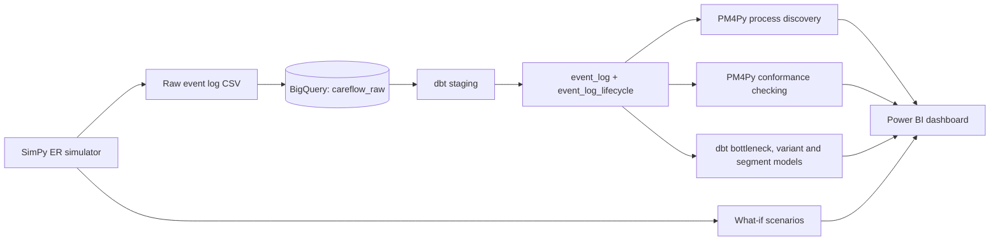

# CareFlow: Clinical Pathway Process Mining

Hospital dashboards usually show the **average ER wait time**. An average cannot tell you *why* patients wait, or what route each patient actually took. CareFlow applies **process mining** to timestamped hospital event logs: it rebuilds the real patient journeys, ranks the bottlenecks, checks every patient against the ideal pathway, and tests what would fix the problem.

**Stack:** Python (SimPy, PM4Py, pandas) · Google BigQuery · dbt · Power BI · GitHub

> **Data note:** real patient records are private, so the event logs come from a simulator I built. The numbers below describe the simulated hospital. They show what the pipeline can find, not facts about real hospitals.

---

## Architecture



---

## Key findings (30 days, 4,921 simulated patients)

| Finding | Result |
|---|---|
| Average time in the ER | 98 minutes |
| X-ray patients sent back to Triage | **41%** (953 of 2,303) |
| Longest queue | **X-Ray: about 42 min average wait for a roughly 12 min scan** |
| Patients who followed the ideal pathway | **80.6%** (3,968 of 4,921) |
| Time lost per looped-back patient | about **24.5 min** (about 389 patient-hours in total) |
| Distinct patient journeys (variants) | 17 |

**What the data says:** the X-ray delay is a queue, not a slow scan. There is one machine and too much demand at peak hours. A second problem sits on top of it: after an X-ray, patients with incomplete paperwork are sent back to Triage and see the doctor a second time.

Splitting the X-ray wait by severity shows how uneven it is: critical patients wait about 9 minutes, while minor cases wait 100+ minutes, because sicker patients are served first.

### What-if simulation (average of 10 random seeds, 30 days each)

| Scenario | Avg stay (min) | 90th percentile stay (min) | Avg X-ray wait (min) | Change in avg stay |
|---|---|---|---|---|
| Baseline | 93.1 | 162 | 37.3 | none |
| Fix the paperwork (no loop-back) | 85.9 | 145 | 39.4 | **-7.2** |
| Add a second X-ray machine | 78.9 | 131 | 2.0 | **-14.2** |
| Both | 70.1 | 114 | 2.2 | **-22.9** |

Fixing the form helps, but it does not shorten the X-ray queue. Capacity is the bigger lever, and the two fixes together deliver the largest improvement.

---

## What each part does

### 1. Simulator (`simulator/`)
- `simulate_er.py` models an ER with **limited staff and equipment** (2 registration desks, 3 triage nurses, 4 doctors, 1 X-ray machine, 2 lab stations, 6 treatment bays), evening arrival peaks, and priority for sicker patients (severity 1 to 5). Queues and bottlenecks emerge from the limits instead of being hard-coded.
- It deliberately includes the paperwork loop-back after X-ray, and logs a `start` and a `complete` event for each activity.
- `what_if.py` runs the scenarios above across several seeds. `load_to_bigquery.py` loads the raw log into BigQuery.

### 2. dbt (`dbt_project/careflow/`)
| Model | Purpose |
|---|---|
| `stg_ehr_events` | Cleans names and types, removes incomplete rows and duplicates |
| `event_log` | The process-mining event log (Case ID, Activity, Timestamp), in order per patient |
| `event_log_lifecycle` | Start and complete events together |
| `activity_durations` | Queue wait vs service time for every activity |
| `transition_stats` | Average time for every hand-off between activities |
| `bottleneck_summary` | Activities ranked by total hours patients spend waiting |
| `case_summary` | One row per patient: stay, waiting, loop-back flag |
| `case_variants`, `variant_summary` | Each patient's full path, and the 17 distinct journeys |
| `transition_segments` | Hand-offs split by age group, severity, gender and staff, for filtering |

**Tests:** not-null and accepted-value checks, no event before arrival, every patient ends in discharge or admission, no negative waits, every patient belongs to exactly one variant, and segment totals match activity totals.

### 3. Process mining (`mining/`)
- `discover_process.py` reads the event log and discovers the as-is process map (directly-follows graph and Petri net) with PM4Py.
- `conformance_check.py` aligns every patient against the ideal pathway, flags deviations, and measures the time lost to each one.

### 4. Dashboard (`dashboard/`)
Power BI connects to BigQuery and shows the KPIs, bottleneck chart, hand-off table, process map, conformance results and filters.

<!--
Add screenshots here once they are in docs/ and uncomment:


-->

---

## Project structure

```
careflow/
├── simulator/        simulate_er.py, what_if.py, load_to_bigquery.py
├── dbt_project/
│   └── careflow/     models/ (staging, marts), tests/
├── mining/           discover_process.py, conformance_check.py
├── dashboard/        careflow.pbix
├── docs/             screenshots and documentation
├── what_if_summary.csv
└── requirements.txt
```

---

## How to run

**Prerequisites:** Python 3.11, a Google Cloud project with a BigQuery dataset, a service-account key (keep it **outside** the repository), dbt-bigquery configured in `~/.dbt/profiles.yml`, and Graphviz installed for the process-map image.

```bash
pip install -r requirements.txt

# 1. generate data and load it
cd simulator
python simulate_er.py --days 30 --seed 42
python load_to_bigquery.py

# 2. transform and test
cd ../dbt_project/careflow
dbt run
dbt test

# 3. mine the process
cd ../../mining
python discover_process.py --source bigquery
python conformance_check.py --source bigquery --upload

# 4. what-if scenarios
cd ../simulator
python what_if.py
```

Set the project ID and key path at the top of each script before running.

---

## Design decisions

- **A simulator with real resource limits** instead of random timestamps, so bottlenecks come from capacity versus demand.
- **Start and complete events**, so queue time and service time can be told apart.
- **Layered dbt (staging, then marts)** with tests, so every number traces back to the raw log.
- **Sums and counts in the segment model**, because averages cannot be added across filters. Averages are recomputed as `SUM(total) / SUM(count)`.
- **What-if runs use several seeds**, because a single run can be luck.

## Limitations

- The data is simulated and the process is simplified (one step at a time per patient, no parallel activities, a single hospital).
- Doctors are assigned randomly in the simulator, so differences between doctors are noise, not performance.
- The 41% loop-back rate is a parameter I set to match the project brief. It is not a discovery about real hospitals. What the project demonstrates is that the pipeline finds it, quantifies it, and tests fixes.
- Runs on the BigQuery sandbox, and the dashboard uses imported snapshots, not live refresh.

---

## Progress

- [x] Week 1: ER event-log simulator and BigQuery warehouse
- [x] Week 2: dbt event-log models and PM4Py process discovery
- [x] Week 3: bottleneck models and Power BI dashboard
- [x] Week 4: conformance checking, what-if simulation, journey variants, filterable hand-offs
- [ ] Final dashboard with filterable process flow
